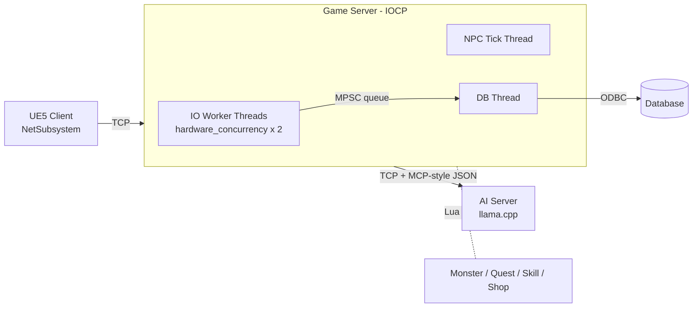

<h1 align="center">Turtle Island</h1>

<p align="center">
  <strong>Multiplayer action RPG with a custom C++ IOCP game server and LLM-driven NPCs</strong><br />
  Capstone project · Unreal Engine 5 client · Windows IOCP server · llama.cpp AI server
</p>

<!-- TODO: gameplay GIF or YouTube link -->
<p align="center"><em>Demo video: coming soon</em></p>

## Overview

| | |
|---|---|
| Period | 2025.09 – 2026.09 |
| Team | 3 people (game server, AI, client) |
| My role | **Game server lead**; also wrote much of the AI server and client networking code |
| Server | C++20 (modules), Windows IOCP, ODBC, Lua 5.5, Box2D collision |
| Client | Unreal Engine 5 (C++) |
| AI | llama.cpp (local LLM), tool-calling NPC agent |

> This repository contains **source code only**. Purchased art and audio assets are excluded due to their licenses, so the client cannot be built as-is.

## Architecture



## Technical Highlights

### 1. IOCP network layer built from scratch
- `AcceptEx` / `WSARecv` / `WSASend` overlapped I/O on a completion port
- Worker thread pool sized to `hardware_concurrency() * 2`
- Fixed-size session pool indexed by slot, so packets carry a slot index instead of pointers
- Automatic reconnect thread for the AI server link

### 2. Safe memory reclamation without locks on the hot path
- **Epoch-Based Reclamation (EBR)**: each worker publishes its epoch while handling one I/O completion; a session or object slot is reused only when no worker can still reference it
- Per-thread reservation slots are `alignas(hardware_destructive_interference_size)` to avoid false sharing
- **Vyukov MPSC queue** hands DB jobs from many worker threads to a single DB thread, with nodes recycled through a Treiber free stack and reclaimed by EBR

### 3. Memory pool benchmark
- Compared queue-based and list-based free lists for fixed object pools (`Server/MemoryPoolBench`)

### 4. Gameplay server
- Room system with host management, NPC spawn areas, and room-wide broadcast
- Server-authoritative collision using Box2D shapes exported from the UE5 editor (`TurtleIslandCollisionEditor`)
- Monster, quest, skill, and shop logic in **Lua** scripts, editable without recompiling the server
- Character progress persisted through **ODBC** on a dedicated DB thread
- Crash dumps via MiniDump

### 5. LLM-driven NPCs
- Separate AI server runs a local model with **llama.cpp**
- NPCs act as agents: the model calls game tools (shop prices, quests, affinity, equipment knowledge) through an MCP-style JSON protocol, capped at 10 tool calls per turn
- Game server forwards chat to the AI server and relays responses back to the player

## Repository Layout

```
Server/
  Server/           Game server (IOCP, rooms, NPC tick, DB, Lua, collision)
  IOCPCore/         Early IOCP core written with C++20 modules
  MemoryPoolBench/  Object pool benchmark
  DummyClient/      Load-test client
  Server/Tests/     Monster spawn, NPC tool-call, and collision tests
Common/             Shared packet protocol and gameplay rules
AI/Server/          llama.cpp NPC agent server
Client/.../Source/  UE5 client C++ code (networking, UI, gameplay)
```

## Build

- Visual Studio 2022, `/std:c++latest` (C++20 modules)
- Server: open `Server/Server.slnx` and build `x64 Release`
- AI server: requires llama.cpp libraries in `AI/lib` and a GGUF model in `AI/Server/Server/models/`
